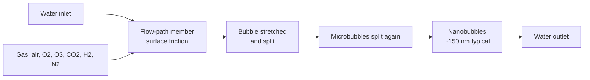

# FAWOO NANOTECH (화우나노텍) — Surface-Friction Nanobubble Generation: Technical Summary

_Last updated: 2026-11-12. Every figure below is company-reported. Each row names the measuring
instrument and the public document it comes from. Figures without a published source are not listed._

## 1. Summary (요약)

FAWOO NANOTECH (화우나노텍, founded March 2020, Bucheon, Korea) makes nanobubble generators that
create bubbles by **friction between flowing water and the wall of a flow-path member**, not by
venturi suction, high-pressure jets or rotor-stator shear. The generators run on air, O₂, O₃, CO₂,
H₂ and N₂, and are used for alkaline-wastewater neutralization with CO₂, carbon capture and
utilization (CCU, 탄소 포집·활용) in concrete, oxygenation of irrigation and aquaculture water,
ozone sterilization, and degassing.

화우나노텍은 물이 유로(流路) 벽면과 마찰하면서 기포가 잘게 쪼개지는 **표면 마찰 방식**으로 나노버블을
만든다. 공기·산소·오존·이산화탄소·수소·질소를 넣어 강알칼리 폐수 중화, CCU 콘크리트, 농업·양식용
산소수, 오존 살균, 탈기에 쓴다.

| Item | Value | Source |
|---|---|---|
| Typical mean bubble size (평균 크기) | ~150 nm | Pamphlet FN2506-E03 (2025-06); technical brochure (2026-01) |
| Typical concentration (개체 농도) | 2–6 × 10⁸ bubbles/mL | Same as above |
| Instrument (측정 장비) | NanoSight LM-10 / NS300 (Malvern Panalytical, NTA — nanoparticle tracking analysis, 나노입자 추적 분석) | Same as above |
| Additives (첨가제) | None. Bubbles form in ultrapure water with no gas or surfactant added (see §3) | Pamphlet FN2506-E03 |
| Recognition (수상) | CES Innovation Awards 2025 (Sustainability & Energy/Power) and 2026 (Human Security for All) | Company press releases |

## 2. How it works (생성 원리)

1. Water and gas enter a flow-path member (유로부재).
2. Friction against the channel surface stretches each bubble until it splits; the split bubbles are
   stretched and split again.
3. The repeated split produces nanobubbles at the outlet.

| Patent family | Scope | Status (company data, 2026-01) |
|---|---|---|
| PCT/KR2020/004646 | Flow-path surface friction (유로 표면마찰) — core patent | Registered in 16 jurisdictions including Korea: Japan, Canada, Australia, India, Indonesia, Vietnam, Mongolia, Iran, Russia, Uzbekistan, Kazakhstan, Azerbaijan, Nigeria, South Africa, Taiwan. US, EU and others under examination |
| PCT/KR2020/010033 | Rotary surface friction (회전 표면마찰) | Filed in 16 jurisdictions including Korea; registered in Korea, others in progress |
| PCT/KR2021/009628 | Large-capacity friction insert (대용량 삽입재) | Filed in 16 jurisdictions including Korea; registered in Korea, others in progress |

## 3. Measured characteristics (측정 결과)

| Test | Result | Instrument / condition | Source |
|---|---|---|---|
| Ultrapure water (Type 1), before the device | 0 particles/mL, DO 3.5 ppm | NanoSight NS300 | Pamphlet FN2506-E03 |
| Same water, 1 pass, **no gas injected** | Mean 84.8 nm, 2.81 × 10⁸ /mL | NanoSight NS300 | Pamphlet FN2506-E03 |
| Same water, 2 passes, no gas injected | Mean 84.3 nm, 4.40 × 10⁸ /mL | NanoSight NS300 | Pamphlet FN2506-E03 |
| Oxygen injection, modular unit | DO (dissolved oxygen, 용존산소) 9 → 32 ppm | — | CES 2026 press release |
| Nitrogen injection, 1 pass (degassing) | DO 8.4 → 0.8 mg/L in tap water | — | Pamphlet; Research Square preprint (§7) |
| Ozone water | ≥ 6.5 ppm generated; ≥ 2.5 ppm after 7 h | — | Pamphlet; arXiv 2311.06943 |
| Hydrogen water | 2.5 ppm at room temperature, 1 atm | Reagent drop method | Pamphlet; technical brochure |

Bubble size and count depend on the water, temperature, gas and number of passes. The rows above
are single test conditions, not guaranteed specifications.

## 4. CO₂ nanobubbles: alkaline neutralization and CCU (중화·탄소 활용)

**Neutralization of Ca(OH)₂ solution** (수산화칼슘 강알칼리 용액, start pH 12.50 at 18.3 ℃, CO₂ at 4 bar):

| CO₂ flow (LPM) | 3.3 | 7.2 | 10 | 22 | 30 |
|---|---|---|---|---|---|
| Final pH | 7.96 | 6.54 | 5.93 | 5.55 | 5.05 |

Source: technical brochure (2026-01); Research Square preprint on CO₂ dissolution (§7).

- With a small CO₂ dose, the modular unit lowers pH from 8.0 to 5.82 (CES 2026 press release).
- Commercial units dissolve 70–420 LPM of CO₂ (about 8–50 kg/h) by model (pamphlet, UNT series).
- **Concrete:** the company reports that CO₂ nanobubble water lets cement content drop 10% while
  compressive strength rises 5% (CES 2026 press release). CO₂ reacts with calcium ions released
  from cement to form calcium carbonate (CaCO₃) inside the concrete.

## 5. Applications (적용 분야)

| Field | Gas | Use |
|---|---|---|
| Industrial wastewater | CO₂ | Neutralizing strongly alkaline wastewater without acid dosing |
| CCU (탄소 포집·활용) | CO₂ | Concrete curing and mineralization; carbonate production (CaCO₃, NaHCO₃) |
| Agriculture / aquaculture | O₂ | Raising DO in irrigation water, nutrient solutions and fish farms |
| Sterilization / cleaning | O₃ | Ozone water for disinfection and washing |
| Water treatment | O₂ / O₃ | River and lake DO, DAF (dissolved air flotation) support, mine-water metal oxidation |
| Process water | N₂ | Degassing to prevent corrosion and oxidation |
| Laundry | Air | Detergent reduction; company cites KATRI test report SPHD21-00001160 |

Documented test cases: [Application_Cases.md](Application_Cases.md).
How generation methods differ: [Comparison_Analysis.md](Comparison_Analysis.md).

## 6. Recognition (인증·수상)

- CES Innovation Awards 2025 — Sustainability & Energy/Power, nanobubble generator for real-time
  CO₂ dissolution.
- CES Innovation Awards 2026 — Products in Support of Human Security for All, modular nanobubble
  generator.
- K-water (Korea Water Resources Corporation) partner startup, October 2023.

## 7. Publications (논문, preprints)

These are preprints, not peer-reviewed journal articles. Titles are translated from Korean.

1. Nanobubble generation by friction and methods to raise bubble concentration — arXiv
   [10.48550/arXiv.2310.16151](https://doi.org/10.48550/arXiv.2310.16151)
2. Extending the half-life of friction-generated nanobubble ozone water, with a virus
   inactivation test — arXiv [10.48550/arXiv.2311.06943](https://doi.org/10.48550/arXiv.2311.06943)
3. Research Square preprints on CO₂ dissolution, N₂ degassing and H₂ water:
   [rs-3836511](https://doi.org/10.21203/rs.3.rs-3836511/v1),
   [rs-3846725](https://doi.org/10.21203/rs.3.rs-3846725/v1),
   [rs-3835918](https://doi.org/10.21203/rs.3.rs-3835918/v1)

## 8. Corrections to earlier versions (정정 이력)

The March 2026 version of this page stated a concentration above 1.0 × 10⁹ /mL, a mean diameter
under 100 nm, a zeta potential of −35 to −45 mV, stability over six months, DO saturation efficiency
above 90%, numerical semiconductor and agriculture gains, and a 10× concentration advantage over a
named competitor. None of these could be matched to a measurement record, so they were removed on
2026-11-12. Figures on this page will change only when a dated measurement is published.

## Contact

[Website](http://www.hwawoo-nano.com) · [Inquiry](mailto:info@hwawoo-nano.com) · Bucheon, Gyeonggi-do, Republic of Korea
